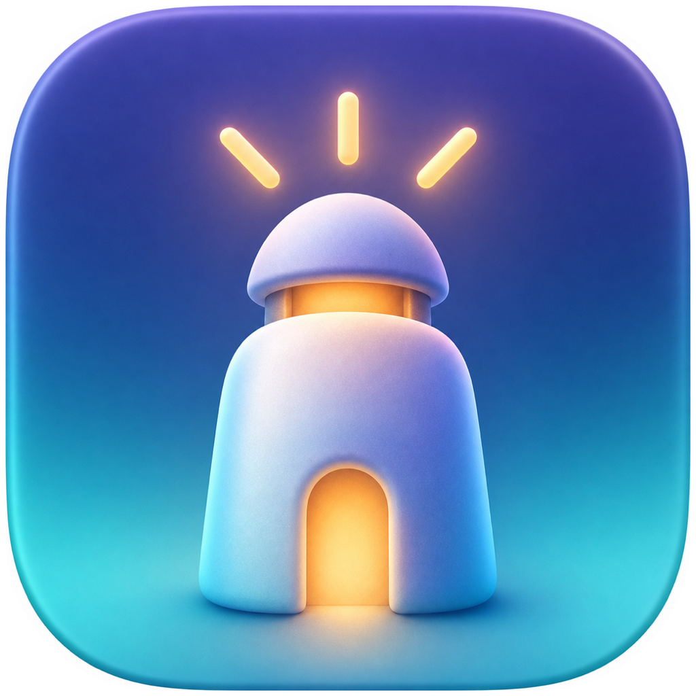

# 小灯塔 LittleBeacon

<p align="center">
  
</p>

小灯塔是一款透明运行的 macOS 家庭规则工具。它只判断孩子当前是否在玩游戏或看视频；非允许时段先提醒三次，仍持续时结束当前游戏或只关闭违规浏览器标签页，并把最小化事件同步给家长 Mac。

它不截屏、不记录按键、不保存完整网址或普通活动历史。违规事件 30 天后自动删除。

## 当前完成度

- 原生 SwiftUI 家长端与孩子端，共用一个应用。
- 独立的每周游戏/视频时段，支持家长分类覆盖。
- Safari、Chrome 当前域名识别；其他浏览器不做视频判断。
- 第 0、60、120 秒提示，第 180 秒执行有限终止。
- 切到合规活动暂停计时，连续五分钟才重置；游戏与视频之间切换继续累计。
- 15、30、60 分钟临时申请与审批。
- 本地执行、断网队列、30 天事件清理、钥匙串凭据。
- Vercel Functions + Neon Postgres API、一次性配对码和家长/孩子分权。
- 家长端每 30 秒获取状态、事件与申请。
- 孩子端同样每 30 秒拉取最新规则；界面显示当前规则版本和最近同步时间，旧版本规则不会覆盖较新的本地规则。
- Sparkle 安全更新：自动检查、手动检查、Ed25519 归档签名与 GitHub Releases 更新源。

详细边界见 [产品简报](docs/PRODUCT-BRIEF.md)，领域词汇见 [CONTEXT.md](CONTEXT.md)，关键取舍见 [ADR](docs/adr)。

## 开源协议

小灯塔以 [MIT License](LICENSE) 开源。可以学习、修改、分发，也欢迎把规则引擎做得更稳；但请不要把它包装成隐蔽监控工具，那会把这盏灯照到一个很奇怪的方向。

## 本地构建

要求 macOS 14+、Xcode 16+。当前项目已在 Xcode 26.6 / Swift 6.3.3 验证。

```bash
./scripts/run-checks.sh
./scripts/package-app.sh
```

产物位于 `outputs/小灯塔.app` 和 `outputs/LittleBeacon-macOS.zip`。当前使用 ad-hoc 签名，适合家庭内手动测试；公开分发前仍需 Apple Developer ID 签名与公证。

## 在线更新与 GitHub 打包

从 `0.2.0` 开始，小灯塔内置 Sparkle。设置页或应用菜单可以手动检查更新，应用也会定期检查 GitHub Releases。更新压缩包使用独立 Ed25519 私钥签名，客户端内只保存公钥；数据库密钥、Vercel 密钥和更新私钥都不会进入仓库。

- 推送到 `main`：`.github/workflows/ci.yml` 自动测试、打包并保留 14 天构建产物。
- 推送 `v*` 标签：`.github/workflows/release.yml` 自动测试并保留一份标签构建产物，用来核对 GitHub 环境也能正常打包。
- 正式在线更新：由 `scripts/publish-release.sh` 使用这台 Mac 钥匙串里的签名私钥，生成已签名压缩包和 `appcast.xml`，再创建 GitHub Release。私钥不会上传到 GitHub Actions。
- 更新源：`https://github.com/lukeliu95/little-beacon/releases/latest/download/appcast.xml`。

发布下一版只需要保证版本标签递增：

```bash
./scripts/publish-release.sh 0.2.1
```

发布前先把 `packaging/Info.plist` 的短版本改为 `0.2.1`，构建号按 `主版本 × 1000000 + 次版本 × 1000 + 修订号` 递增，并提交到 `main`。首次启用在线更新的 `0.2.0` 仍需在两台 Mac 各手动安装一次；以后才由应用自己接班。这个“第一次还得走过去一下”的尴尬，属于时间机器尚未完工，不属于程序偷懒。

## 首次安装

1. 把 `小灯塔.app` 拖进 `/Applications`。
2. 打开应用，选择“家长端”或“孩子端”。
3. 允许通知。
4. 孩子端首次读取 Safari/Chrome 时，macOS 会请求“自动化”权限；只授权小灯塔控制对应浏览器。
5. 在孩子 Mac 的标准账户中运行 `./scripts/install-auto-recovery.sh`，输入家长管理员密码，启用登录启动与异常恢复。

没有 Developer ID 时，Gatekeeper 可能要求在“系统设置 → 隐私与安全性”中确认首次打开。不要为了省一步而关闭整个 Gatekeeper。

## Vercel 与 Neon 部署

当前家庭测试环境已经部署在 `https://little-beacon-api.vercel.app`，并连接 Vercel Marketplace 中的 Neon 数据库。下面步骤用于重新部署或迁移到另一个 Vercel 项目。

后端目录是独立 Vercel 项目：

```bash
cd backend
npm install --omit=optional --ignore-scripts --registry=https://registry.npmjs.org
vercel link
vercel integration add neon
```

在 Vercel 项目中配置三个环境变量：

- `DATABASE_URL`：Neon 集成自动提供或手动复制的连接串；
- `SETUP_KEY`：至少 32 字节随机部署密钥；
- `PAIRING_SECRET`：另一枚独立的至少 32 字节随机密钥。

可用 `openssl rand -base64 32` 分别生成后两项。随后部署：

```bash
vercel deploy --prod
```

访问 `https://你的域名/api/health` 验证数据库连接。第一次在家长端输入 Vercel 地址和 `SETUP_KEY` 时，API 会自动建立 schema、家庭空间和家长凭据；之后生成 10 分钟有效的六位配对码，在孩子端完成配对。

## 权限与安全边界

- 孩子必须使用标准 macOS 账户，家长持有管理员密码。
- 客户端永不持有数据库密码；家长和孩子拿到权限不同的随机设备凭据，保存在钥匙串。
- 配对码单次使用、十分钟过期，连续错误五次后失效。
- 孩子端可见且自动恢复，但第一版不是企业 MDM，不宣称可以抵抗熟练的系统级主动绕过。
- 结束游戏可能导致未保存进度丢失；浏览器只关闭当前违规标签页。

## 目录

- `Sources/LittleBeaconCore`：规则、分类、时段和违规状态机。
- `Sources/LittleBeaconApp`：SwiftUI、前台识别、通知、持久化、钥匙串与 API 客户端。
- `Tests/LittleBeaconCoreTests`：规则和提醒状态机测试。
- `backend/api`：Vercel Functions 路由。
- `backend/src`：数据库、鉴权、验证和数据映射。
- `backend/db/schema.sql`：可审阅的数据库 schema。
- `backend/test`：令牌、配对和规则验证测试。
- `packaging`：应用与自动恢复 plist。
- `branding`：应用图标原图、macOS 图标资源与资产目录。
- `scripts`：测试、打包和可选自动恢复安装脚本。
