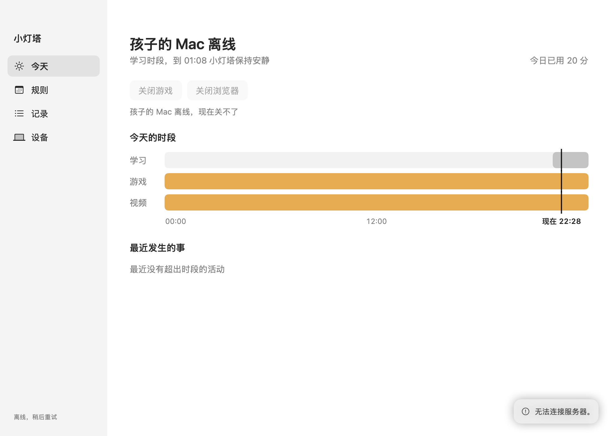
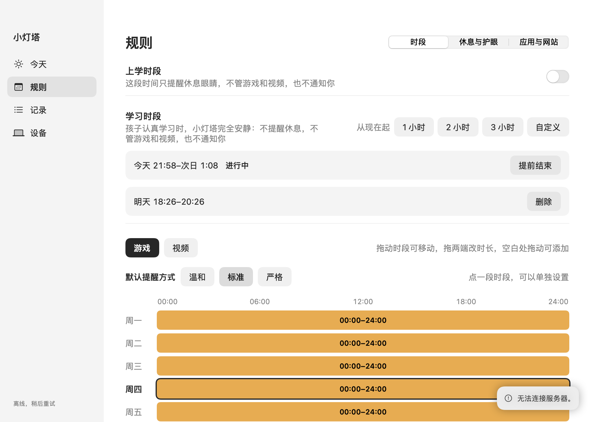
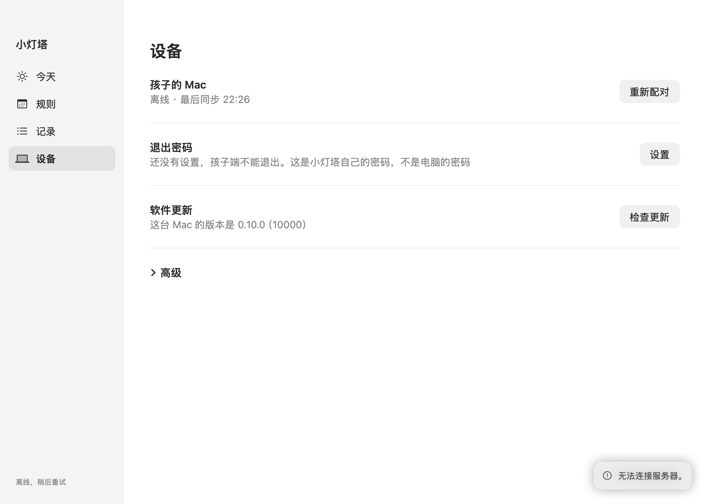
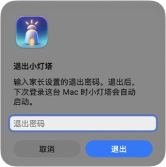
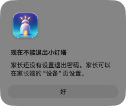
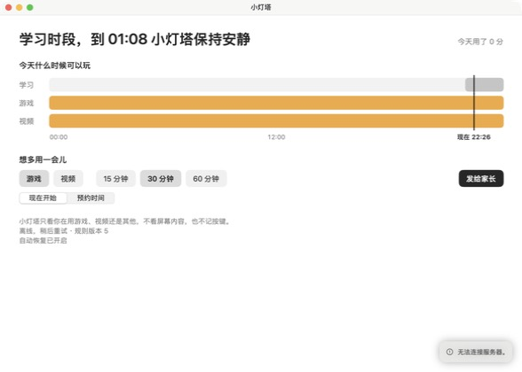

# 退出密码、自动恢复修正、学习时段：验收记录

- 日期：2026-11-26
- 对应：issue lukeliu95/little-beacon#19，ADR-0018，方案 `docs/specs/2026-11-26-exit-password-watchdog-study-sessions.md`
- 基线：`main` `ff98bdf`（v0.10.0）

## 查到的根本原因

用隔离测试副本在这台 Mac 上按 0.10.0 的方式装后台服务后复现：由后台服务启动的孩子端，在启动时准备休息提示音的地方卡住约 60 秒（等待系统声音服务），这段时间没有菜单栏图标，也不执行任何规则，看起来就是“没有拉起”。提示音改为后台加载后，启动 1 秒内就正常。另外修正了安装脚本的注册顺序、等待和失败提示，以及系统默认 10 秒才重启的问题（见 ADR-0018）。

## 自动检查

| 项目 | 结果 |
| --- | --- |
| `scripts/run-checks.sh` | 通过：Swift 核心 159 个、App 60 个测试通过，后端 29 个测试通过，两个 plist 校验通过 |
| 新增 Swift 测试 | 退出密码校验值正确/错误、太短拒绝、错 5 次锁 1 分钟、规则里清除密码编码为 `null`；学习时段边界、比上学时段优先、时段内护眼提醒也关、过期清理、非法值不生效、最多 20 段；配对后有密码输对退出并停掉自动恢复、输错不退出、输入时开始强制休息不退出、没设密码弹说明；后台服务配置必须有 5 秒、安装脚本自带的配置和打包的一致、何时由孩子端补注册服务 |
| 新增后端测试 | 两个新字段默认值、非法值被拒绝、清除密码的 `null` 被保存、老客户端整份上传时不丢 |

## 隔离测试副本上的实测

副本：应用 ID `app.littlebeacon.mac.qa`，数据目录用 `CFFIXED_USER_HOME` 隔离，钥匙串服务名单独，不注册登录项。后台服务用单独的名字，配置放在 scratchpad，没有装进系统目录。测试结束后已卸下服务、结束进程、从系统应用列表里移除。这台 Mac 上真实的家长端数据没有被改动。

| 场景 | 结果 |
| --- | --- |
| 安装后自检（`kill -9`） | 通过，1.8–1.9 秒自动回来 |
| 连续结束 3 轮 | 每轮都在 2 秒内回来，始终只有 1 个副本 |
| 普通方式结束（SIGTERM） | 立即回来 |
| 普通方式打开的副本 | 30 秒内把后台服务注册回来，由服务那一份接手，最后只剩 1 个 |
| 退出时输错密码 | 不退出，进程号不变 |
| 退出时输对密码 | 进程退出，服务卸下，15 秒后仍没有被拉起；重新注册服务（相当于下次登录）后正常启动 |
| 家长没设密码时退出 | 弹出说明，继续运行 |
| 学习时段内孩子端窗口 | 标题“学习时段，到 … 小灯塔保持安静”，时段图有“学习”条，用机 0 分钟，底部“自动恢复已开启” |

输入密码这一步：系统不允许自动化工具往密码框里打字，所以用测试副本专用的读文件答案代替键盘输入，走的是同一段核对和退出代码。

## 界面截图

| 页面 | 截图 |
| --- | --- |
| 家长端“今天”，学习时段内 |  |
| 家长端“规则 → 时段”，学习时段 |  |
| 家长端“设备”，退出密码 |  |
| 孩子端退出密码输入框 |  |
| 孩子端没设密码时的说明 |  |
| 孩子端窗口，学习时段内 |  |

检查中改掉的问题：“从现在起 1 小时”等按钮在窄窗口里折行，已改为不折行；跨过半夜的学习时段，结束时间前加“次日”。

## 没有验证的部分

- 真实的孩子 Mac：要等后端部署、0.11.0 发版、孩子 Mac 升级并重新跑安装命令后才能验。
- 在真实输入框里用键盘输入密码：自动化做不到，需要 Luke 在孩子 Mac 上试一次。
- 后端新字段：只跑了本地测试，没有部署到线上。
- 家长端设密码后同步到孩子端：两端的代码都有测试，但没有在两台真机之间跑过。

## 后端部署记录

- 时间：2026-11-26 22:42（日本时间）
- 来源：`main` `d56ab27`（PR #20 合并后），`git archive` 干净导出
- 新部署：`little-beacon-l4n8cjh5s`，已指向 `little-beacon-api.vercel.app`
- 回滚点：`little-beacon-a7uayj5u6`（上一个线上部署）
- 表结构：无改动（新字段都在规则 JSON 里）

| 检查 | 结果 |
| --- | --- |
| 其余接口无凭据请求 | 401 或 405，没有 404，路由都在 |
| `/api/health` | **500：数据库 Neon 报“账户或项目超出额度”（HTTP 402）** |
| 真实孩子端同步 `/api/sync/child` | **500，原因同上** |

数据库超额不是这次部署造成的：部署前的旧版本在 21:43–21:48 就已经每 30 秒收到一次孩子端同步，全部因为同一个 402 失败（日志只保留到这么早）。在额度恢复之前，两端都同步不了：家长改的规则、退出密码、学习时段都到不了孩子端；孩子端按本机已有的规则继续运行。

## 0.11.0 发版记录

在临时目录新 clone 的 `main` 上运行 `scripts/publish-release.sh 0.11.0`，没有碰主目录的 `outputs`。

| 项目 | 结果 |
| --- | --- |
| 版本号 PR | #21，CI 通过后合并，`main` `db11baf` |
| 发版前检查 | 脚本内 `run-checks.sh` 全部通过（Swift 159 + 60，后端 29，plist） |
| 发布 | `v0.11.0` 指向 `db11baf`，标签 22:47:56，Release 22:48:03，比 Release 早 7 秒，已是最新版 |
| 公开核对 | 从公开地址下载更新源和安装包：版本 0.11.0，构建号 11000，大小 3577464 字节，和本地打包产物逐字节一致 |
| 更新签名 | 通过；改坏一个字节后验证失败 |
| 安装包 | Universal 2（x86_64 + arm64），代码签名校验通过 |
| 公开的安装脚本 | `raw.githubusercontent.com` 上已是新版本 |

发版后补的一处：安装脚本最低要求改成 0.11.0（构建号 11000）。0.10.0 被后台服务启动时会卡一分钟，装上也像“没拉起”，所以在旧版本上直接拒绝并提示先升级。

还没做的：数据库额度恢复；孩子 Mac 升到 0.11.0 后运行新的安装命令，看自检通过；家长端设退出密码后在孩子端试一次输错和输对。
